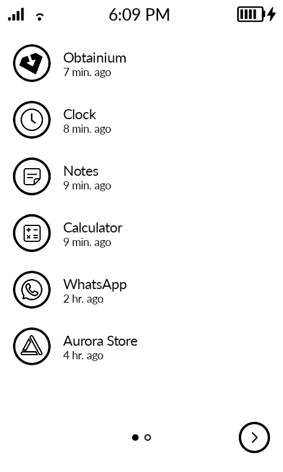
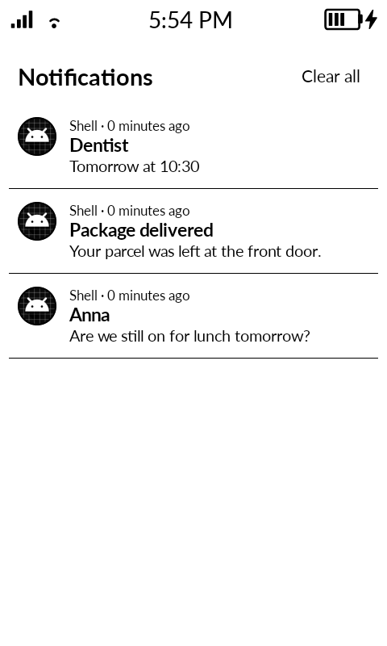

	
	<h2>Katapult — A simple grid launcher for Mudita Kompakt</h2>

A fork of [Katapult](https://github.com/gezimos/Katapult) by Gezim, maintained and modified by Richard Krikler since October 2026.

> [!NOTE]
> To install, download the latest APK from [Releases](https://github.com/richardkrikler/Katapult/releases) and install it on your device using Mudita Center or ADB/webADB.

    <table>
        <tr>
            <td></td>
            <td></td>
            <td></td>
            <td></td>
        </tr>
        <tr>
            <td></td>
            <td></td>
            <td></td>
            <td></td>
        </tr>
        <tr>
            <td></td>
            <td></td>
        </tr>
    </table>

## Setup

- **Settings**: Long-press on any empty area of the home screen
- **Replace home apps**: Long-press on the Phone, SMS, or extra row shortcuts
- **Clock/Date shortcut**: Long-press on the clock or date to assign an app

## What this fork adds

- **Recent apps**: swipe left to right on the home screen for a list of the apps you used since the phone started, newest first, with how long ago. Tap an app to return to it where you left it. Needs Usage Access.
- **Notification list**: swipe down from the status bar, from any app, to see your notifications instead of MuditaOS's quick settings. Tap one to open it, long-press to clear it, swipe up to close. Needs the Action Service.
- **Open notifications from the lock screen**: tap an app in the Lockscreen Notifications widget to unlock and open its newest notification. The Mudita Phone row opens the call log.
- Notification counts no longer stay one too high when an app groups its notifications.
- English only, and the update checker follows this fork's releases.

See the [changelog](CHANGELOG.md) for details.

## Features

### Home screen
- **Clock and date**, with the next alarm, battery %, and weather (Kompakt only, from the Mudita weather app) above it. Clock and date formats are configurable.
- **Dock** with Phone, SMS and the All Apps button, plus an optional **extra dock row** of 3 shortcuts. Any slot, the clock and the date can open an app or app shortcut.
- **Music widget** with playback controls and song info, works with third-party players like Auxio, Fossify Music, Spotify, Foobar, CalmCast, AntennaPod.
- **Long-press an app in home**: App Info, Context Menu, Clear Notifications, Edit Shortcut or Disabled.
- **Double tap in home**: toggle brightness or lock the phone.
- **Text Backgrounds**: islands behind the clock, date and apps.
- **Hide All Apps Button**, Hide Status Bar, Hide Status Bar Clock (Kompakt only, covers the duplicate clock).

### All Apps
- **3x4 app grid**, paged with swipes or arrow buttons, horizontal or vertical, with optional infinite scroll.
- **Order Apps**: alphabetical (with your manual reorder), most recent or most used.
- **App context menu**: Reorder, Rename, Change Icon, App Shortcuts, Hide, App Info, Notifications, Clear Notifications, Uninstall.
- **App Shortcuts**: enable the shortcuts an app publishes (a timer, a conversation) as their own tiles. Websites and PWAs added from the browser land here too.
- **Hide apps** from the context menu, or in bulk from the home long-press menu.

### Appearance
- **Icon tinting and shaping** for a uniform black & white look (works with ~95% of apps). Monochrome icons are used when an app provides one.
- **Change Icon**: bundled Katapult icons, 133 Material icons, or your own PNG/SVG.
- **Icon Shape** (circle or rounded) and **Icon Size** (72 x 72 or 80 x 80).
- **Theme Mode**: System, Light or Dark.
- **Hide App Names**, and a simple wallpaper (not managed by Android).

### Notifications
- **Notification indicators** on app icons. On the Kompakt, Mudita Phone and Messages badges read the call log and SMS directly, including declined calls and voicemail.
- **Notification list** from the status bar (see above).
- **Lockscreen Notifications (experimental)**: per-app notification counts on the lock screen, with an app allowlist and sort order. Tap an app to open its newest notification. Long-press the widget to move or resize it, tap to save.
- **Lockscreen Music Controls** (Kompakt only): controls on the lock screen for players other than Mudita's own.
- **Lockscreen Message**: your own text at the bottom of the lock screen.

### Screensaver (experimental)
- An always-on style screen with the home clock, date, alarm, battery, weather and up to 4 notification rows, optionally over a wallpaper.
- Start it with a pinch on home, from the home long-press menu, the Screensaver icon, or automatically on the power button.
- Update Mode: Static, Auto or Timed. Select Katapult once in the system Screen saver settings (Settings → Screensaver opens it).

### E-Ink
- **E-Ink Refresh on Home**: flashes the screen when you press home, to clear ghosting.
- **E-Ink Mode** (Kompakt only): Disabled, Clear, Contrast or Reading.

### System
- **Check for Updates**: downloads and installs new releases from GitHub.
- **Config Export/Import** as JSON, and Clear All Data.
- **Permissions** overview, Search Settings, Set as Default Launcher.

## Permissions

| Permission | Why |
|------------|-----|
| `QUERY_ALL_PACKAGES` | List all installed apps |
| `PACKAGE_USAGE_STATS` | Recent apps, and ordering apps by most recent or most used (Usage Access) |
| `WRITE_SETTINGS` | Double-tap brightness toggle |
| `REQUEST_DELETE_PACKAGES` | Uninstall apps from the context menu |
| `REQUEST_INSTALL_PACKAGES` | Install updates from Check for Updates |
| `INTERNET` | Check for Updates |
| `BIND_NOTIFICATION_LISTENER_SERVICE` | Read notifications for badges, the notification list and the lock screen |
| `READ_CALL_LOG`, `WRITE_CALL_LOG` | Missed call badge on Mudita Phone, and clearing it (Mudita Kompakt only) |
| `READ_SMS` | Unread SMS badge on Mudita Messages (Mudita Kompakt only) |
| `com.mudita.weather.PERMISSION_READ_WEATHER_DATA` | Show Weather (Mudita Kompakt only) |
| `BIND_ACCESSIBILITY_SERVICE` | The Katapult Action Service. Draws the experimental lockscreen widgets over the lock screen, since an accessibility overlay is the only way a normal app can display there. Also used for the notification list pull-down, the status bar clock cover, locking the phone and the screensaver on the power button. The permission sounds scary, but Katapult reads only the lock screen and the status bar, never your apps. It records and shares nothing; this open source code is the proof. |

## FAQ

| Question | Answer |
|----------|--------|
| Will it have customizable fonts? | No. |
| Will it have a customizable grid? | No. |
| Will it have third-party icon packs? | No. |
| Will it get as many features as inkOS? | No. |
| Can I add more apps to the home screen? | No. |
| Can I adjust the opacity of the wallpaper? | No. |
| Can I change date/clock formats? | No. It follows Android settings. Change it there. |
| Can I add AM/PM to a 12-hour clock? | Yes. It's in the settings. |
| Can I reorder apps? | Yes. Long-press an app, tap Reorder, then tap another app to swap. Tap Save when done. |
| Will this launcher have a notification tray? | Yes, swipe down from the status bar (needs the Action Service). |
| Will it have a letters screen? | No. |

## Troubleshooting

### Notification indicator not showing
Go to Settings > Notification Log and check if the notification exists in Android. Many apps require Google Play Services for push notifications. If it's not in the log, it doesn't exist for Android and Katapult can't read it.

### Notification not clearing
Check the Notification Log. If Android doesn't clear it, Katapult can't either.

### How to disable notification dots for a specific app
There are no allowlists. Go to Settings > App Notifications, tap the app, and disable "Allow notification dot".

## Acknowledgments

- The experimental lockscreen widget's approach — drawing over the keyguard through an accessibility overlay — was inspired by [Lockscreen Widgets](https://github.com/zacharee/LockscreenWidgets) by Zachary Wander. Katapult's implementation is its own; no code was copied.

## Appreciation

This project builds on [Katapult](https://github.com/gezimos/Katapult) by Gezim, who created the launcher and its design. Thank you for the original work and for releasing it as open source. If you enjoy Katapult, consider [supporting Gezim](https://buymeacoffee.com/gezimos).
